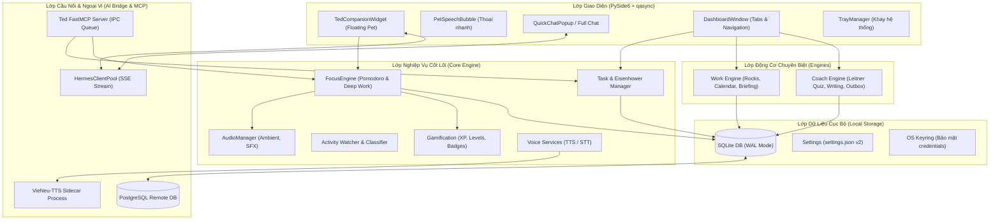

# System Architecture

> Kiến trúc hệ thống, luồng dữ liệu và thiết kế các phân hệ của **Ted Desktop Companion**.

---

## 1. Kiến trúc tổng quan (High-Level Architecture)

Hệ thống được xây dựng theo mô hình **Local-First Event-Driven Desktop Architecture** trên nền tảng Python 3.11, kết hợp giao diện PySide6 (Qt) chạy trên vòng lặp bất đồng bộ `qasync` và cầu nối AI hai chiều qua FastMCP & HTTP/SSE.

---

## 2. Chi tiết các phân hệ chính

### 2.1. Phân hệ Giao diện người dùng (UI Layer)
- **`TedCompanionWidget`**: Cửa sổ không viền (`FramelessWindowHint`), luôn nổi trên các ứng dụng khác (`WindowStaysOnTopHint`). Sử dụng `QPainter` để vẽ ảnh động Chibi tương ứng với trạng thái (nghỉ ngơi, tập trung, vui mừng, ngủ gật).
- **`PetSpeechBubble`**: Bong bóng thoại hiển thị gợi ý, liên kết tới task hiện tại, cho phép tương tác trực tiếp chỉ bằng một cú nhấp chuột.
- **`DashboardWindow`**: Trung tâm điều khiển toàn diện của ứng dụng bao gồm các tab:
  - Quản lý phiên tập trung & phân tích hiệu suất làm việc.
  - Ma trận Eisenhower & Danh sách công việc.
  - Tab động theo engine (`work`: Rocks & Calendar; `coach`: Quiz Spaced Repetition & Lộ trình học).
  - Hub gamification: Huy hiệu, bảng xếp hạng, chuỗi ngày streak.
  - Cài đặt hệ thống: Giọng đọc, kết nối AI, giao diện và cập nhật.

### 2.2. Phân hệ Lõi & Quản lý trạng thái (Core Subsystem)
- **`FocusEngine`**: Điều phối đồng hồ đếm ngược phiên tập trung (Pomodoro), tính toán số lần xao nhãng, kích hoạt nhắc nhở Mindful Ping định kỳ, phát âm thanh hoàn thành phiên.
- **`GamificationHub`**: Tính toán và cộng điểm XP vào `XpLedger` dựa trên hành động thực tế của người dùng, tự động mở khóa các huy hiệu tuần và trang phục nhân vật.
- **`ActivityWatcher`**: Tích hợp công cụ giám sát cửa sổ hoạt động (`WindowInspector`), phân loại ứng dụng đang dùng (Học tập / Làm việc / Xao nhãng) và lập báo cáo ngày.

### 2.3. Phân hệ Động cơ nghiệp vụ (Engine Layer)
Hệ thống hỗ trợ cơ chế plug-and-play thông qua file cấu hình `module.yaml`:
- **`Work Engine`**: Cung cấp khả năng lập kế hoạch làm việc buổi sáng (Daily Briefing), quản lý mục tiêu chiến lược (Rocks), và kết nối đồng bộ lịch công tác với cảnh báo trước giờ họp.
- **`Coach Engine`**: Ứng dụng thuật toán lặp lại ngắt quãng Leitner 5 hộp nhớ. Tự động tính toán ngày đến hạn ôn tập của từng thẻ kiến thức, hỗ trợ chấm điểm bài tập tự luận và gửi báo cáo ngoại tuyến qua hàng đợi outbox.

### 2.4. Phân hệ Cầu nối AI (Hermes Bridge & FastMCP)
- **`HermesClientPool`**: Quản lý nhiều hồ sơ kết nối AI độc lập. Hỗ trợ truyền phát thời gian thực (SSE Streaming) câu trả lời từ AI về khung chat.
- **`HermesMoodTagStreamParser`**: Lắng nghe dòng stream văn bản từ AI, bóc tách các thẻ `<mood:...>` để thay đổi biểu cảm nhân vật tức thì mà không hiển thị các thẻ này ra giao diện người dùng.
- **`Ted FastMCP Server`**: Cung cấp giao diện chuẩn Model Context Protocol (MCP) cho phép các mô hình AI hoặc công cụ mở rộng (Claude Desktop, Cursor) có thể trực tiếp ra lệnh cho Ted thông qua hàng đợi IPC JSON an toàn.

### 2.5. Phân hệ Giọng nói (Voice Pipeline)
- **Text-to-Speech (TTS)**:
  - Chế độ máy chủ: Kết nối tới API âm thanh tương thích chuẩn OpenAI.
  - Chế độ cục bộ: Quản lý tiến trình phụ `VieNeu-TTS Sidecar` chạy ngầm, tận dụng bộ tiền xử lý ngắt nghỉ tiếng Việt chuyên sâu và phát trực tiếp qua luồng âm thanh PCM không ngắt quãng (Gapless Stream).
- **Speech-to-Text (STT)**:
  - Hỗ trợ ghi âm microphone qua thư viện WAV Recorder và gửi đến Faster-Whisper server hoặc chạy binary `whisper.cpp` cục bộ.

### 2.6. Phân hệ Dữ liệu & Đồng bộ (Data & Sync Subsystem)
- Cơ sở dữ liệu SQLite cục bộ được kích hoạt chế độ **WAL (Write-Ahead Logging)** và thời gian chờ khóa 5000ms, đảm bảo an toàn truy xuất đồng thời giữa luồng giao diện và các tiến trình nền.
- Đồng bộ đám mây 2 chiều với cơ sở dữ liệu PostgreSQL từ xa thông qua Change Data Capture (CDC) bằng SQLite triggers.
